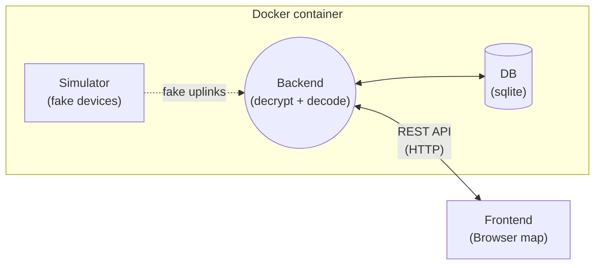

# IoT Project

An end to end IoT system: devices send encrypted uplinks, a backend
decrypts and stores the data, and a browser map shows it live.

> Proof of concept. Course project, autumn 2026.

## How it works



## Repository layout

| Folder      | Contents                                      |
|-------------|-----------------------------------------------|
| `mcu/`      | Microcontroller firmware for the devices      |
| `frontend/` | Browser map frontend                          |
| `backend/`  | Decryption, decoding, REST API, SQLite, simulator |
| `docs/`     | Message formats and agreements between teams  |

## Try it without hardware

```bash
git clone https://github.com/ultrashpanda/iot && cd iot
docker compose up
```

The simulator adds fake devices, so the map is live straight away.

## Status

- [x] MCU firmware (v0.7)
- [ ] Backend
- [ ] Frontend

## Alternative backend

A working backend MVP (TTN MQTT, simulator, SQLite, `GET /api/devices`, serves the frontend) lives on
the branch [`feat/backend-mvp`](https://github.com/ultrashpanda/iot/tree/feat/backend-mvp/backend).
It is kept unmerged on purpose, so `backend/` stays free for the backend team's own code.
See [its README](https://github.com/ultrashpanda/iot/blob/feat/backend-mvp/backend/README.md) to run it.

## Team and license

Names, course, supervisor. License to be decided.
