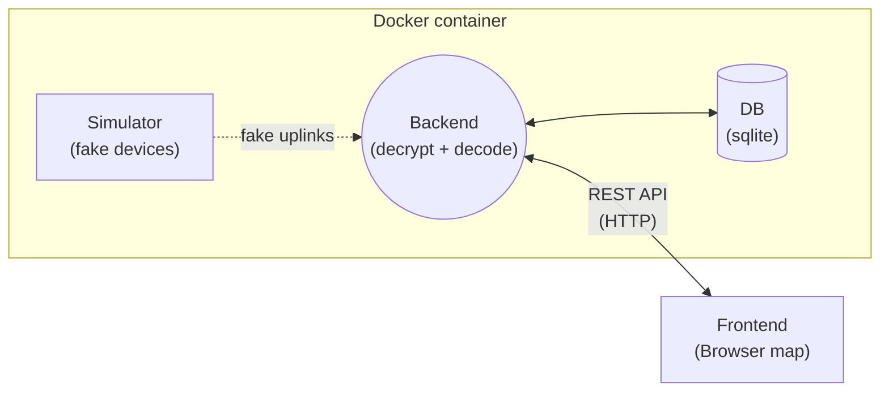

# IoT Project

An end to end IoT system: devices send encrypted uplinks, a backend
decrypts and stores the data, and a browser map shows it live.

> Proof of concept. Course project, autumn 2026.

## How it works



## Repository layout

| Folder      | Contents                                      |
|-------------|-----------------------------------------------|
| `MCU/`      | Microcontroller firmware for the devices      |
| `Frontend/` | Browser map frontend                          |
| `Backend/`  | Decryption, decoding, REST API, SQLite, simulator |

## Try it without hardware

```bash
git clone https://github.com/ultrashpanda/iot && cd iot
docker compose up
```

The simulator adds fake devices, so the map is live straight away.

## Status

- [ ] MCU firmware
- [ ] Backend
- [ ] Frontend

## Team and license

Names, course, supervisor. License to be decided.
