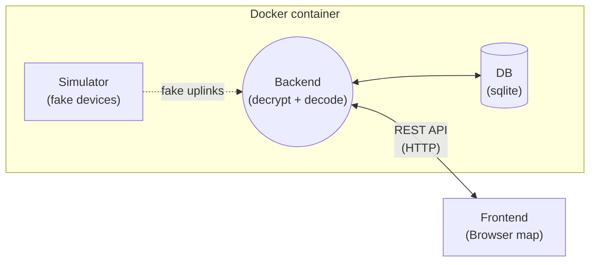

# IoT Project

An end to end IoT system: devices send encrypted uplinks, a backend
decrypts and stores the data, and a browser map shows it live.

> Proof of concept. Course project, autumn 2026.

## How it works



## Repository layout

| Folder      | Contents                                      |
|-------------|-----------------------------------------------|
| `mcu/`      | Microcontroller firmware for the devices      |
| `frontend/` | Browser map frontend                          |
| `backend/`  | Backend team's code (decoding, REST API, SQLite, simulator) |
| `backend-alt/` | Alternative backend MVP that works today (Rust) |
| `docs/`     | Message formats and agreements between teams  |

## Try it without hardware

```bash
git clone https://github.com/ultrashpanda/iot && cd iot/backend-alt
cargo run
```

Then open http://localhost:8080. The simulator adds 20 fake devices, so the map is live straight away.
For real nodes (TTN key, Google key, node positions), see [backend-alt/README.md](backend-alt/README.md).

## Status

- [x] MCU firmware (v0.8)
- [ ] Backend (team code in `backend/`)
- [x] Alternative backend (`backend-alt/`)
- [x] Frontend

## Alternative backend

`backend-alt/` is a working backend MVP: TTN over MQTT, decoding, SQLite, Wi-Fi geolocation,
downlinks (uplink interval, restart), the simulator and `GET /api/devices`. It also serves the
frontend. It lives in its own folder, so `backend/` stays free for the backend team's own code.

## Team and license

Names, course, supervisor. License to be decided.
